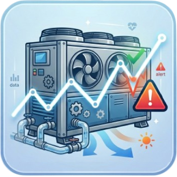

<p align="center">
  
</p>

<h1 align="center">HVAC Desktop Analyzer</h1>

<p align="center">Analyze HVAC measurements on a Windows or Linux desktop: import a dataset, chart it per circuit, find what is out of band and turn it into a report you can hand over.</p>

<p align="center">
  <a href="https://github.com/JosueJosende/hvac-desktop-analyzer/releases/latest">Download the latest installer</a> ·
  <a href="https://github.com/JosueJosende/hvac-desktop-analyzer/releases">Release history</a> ·
  <a href="CURRENT_RELEASE.md">Current release details</a>
</p>

This repository distributes the installers and the release metadata for the desktop application. It does not publish the application source, which is private.

## Downloads

| Platform | File | Notes |
| --- | --- | --- |
| Windows 10 or later (x64) | `HVAC-Desktop-Analyzer-<version>-win-x64.exe` | Installer. Installs for all users, so Windows asks for elevation, and you can choose the destination folder. |
| Linux (x86_64) | `HVAC-Desktop-Analyzer-<version>-linux-x86_64.AppImage` | Portable. Make it executable and run it. |

Both files are listed on the [releases page](https://github.com/JosueJosende/hvac-desktop-analyzer/releases). File names carry the version, so link to the release page rather than to a single asset.

## What the application does

| Capability | What it gives you |
| --- | --- |
| Import and chart | Load a measurement file and inspect every variable and circuit on a chart, with the alarms of the analysed range beside it. |
| Analysis | Per-variable statistics, correlations between variables and detection of values outside their expected band. |
| Diagnostics | Review findings against the equipment, and optionally compose an AI-assisted diagnostic report. |
| Field report | Write up purpose, technical diagnosis, actions taken, tests, observations, recommended actions and equipment state before and after. |
| Export | Save the analysis as a standalone HTML file or as a PDF report. |
| Tests and telemetry | Keep saved tests, recorded telemetry and annotations, and share or move them between equipment. |
| Accounts | Work as a guest with everything stored locally, or sign in to synchronise across machines and organisations. |
| Languages | English, Spanish and Catalan, with a dark theme. |

## Installation

### Windows

1. Download the `.exe` from the releases page.
2. Run it. Windows asks for elevation because the installer is per-machine, and it offers a destination folder.
3. The build is not code-signed, so SmartScreen may warn that the publisher is unknown. Check the SHA-256 in [CURRENT_RELEASE.md](CURRENT_RELEASE.md) first, then continue through **More info** → **Run anyway**.

### Linux

```bash
chmod +x HVAC-Desktop-Analyzer-<version>-linux-x86_64.AppImage
./HVAC-Desktop-Analyzer-<version>-linux-x86_64.AppImage
```

The AppImage needs FUSE. On a system without it, run the same file with `--appimage-extract-and-run`.

## Updates

The packaged application checks this repository when it starts and downloads a newer version automatically, verifying the SHA-512 recorded in the update metadata before it applies it. No manual download is needed to stay current.

## Where your data lives

The application keeps its database, configuration and logs in the per-user application data directory of your operating system. Nothing leaves the machine unless you sign in and use the cloud synchronisation features.

## Verify what you downloaded

[CURRENT_RELEASE.md](CURRENT_RELEASE.md) records the size and SHA-256 of the published installers. The `latest.yml` and `latest-linux.yml` assets are the update metadata the application itself reads; they carry the SHA-512 of the file they point at.

## Scope of this repository

Installers, their block maps and the update metadata only. There is no application source here.
